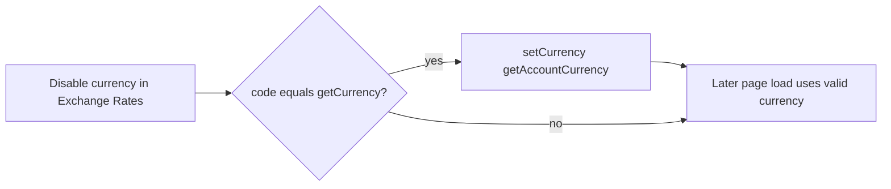

# Reset session currency when disabled

## Problem

UI display currency lives in sessionStorage (`getCurrency` / `setCurrency` in [`sessionStorage.ts`](../../apps/koku-ui-hccm/src/utils/sessionStorage.ts)) and is sent as `currency=` on report APIs. Disabling a currency in Exchange Rates only calls `DELETE settings/currency/enabled/{code}/` and never clears that session value ([`enableRate.tsx`](../../apps/koku-ui-hccm/src/routes/settings/exchangeRates/exchangeRate/components/enable/enableRate.tsx)). Overview, OCP details, explorer, etc. keep requesting the disabled code and the API returns `currency: "AED" is not an enabled currency.`

## Recommendation

Do **not** hardcode USD. Reset to **account default currency** via `getAccountCurrency()` (already defaults to `USD` when unset). The backend marks the account default `is_disableable: false`, so that fallback stays enabled. This matches how [`initCurrency`](../../apps/koku-ui-hccm/src/store/accountSettings/accountSettingsReducer.ts) seeds the UI currency.

## Approach

### 1. Reset on successful disable (primary fix for the repro)

In [`enableRate.tsx`](../../apps/koku-ui-hccm/src/routes/settings/exchangeRates/exchangeRate/components/enable/enableRate.tsx), after a successful disable (`!settingsError`, toggle off):

- If `settings.code === getCurrency()`, call `setCurrency(getAccountCurrency())`.
- No toast required; silent reset is enough for this flow.

### 2. Defensive recovery when options load (stale sessions / other tabs)

In [`currency.tsx`](../../apps/koku-ui-hccm/src/routes/components/currency/currency.tsx), after `useCurrency()` returns a completed list:

- If the current `currencyValue` / `getCurrency()` is not in the enabled options, call `setCurrency(getAccountCurrency())` and invoke `onSelect` with that value so parents (overview, details, explorer) re-navigate and rebuild report queries.
- Skip when `isSessionStorage` is false (Display/Calculations account-default editors).

Extract a small helper (e.g. in [`routes/components/currency/utils`](../../apps/koku-ui-hccm/src/routes/components/currency/utils)) such as `resolveEnabledCurrency(enabledCodes)` that returns the current code or the account-default fallback, to keep enable + Currency paths consistent.

### 3. Keep the global dropdown list fresh

Mirror [`useCurrencySettings`](../../apps/koku-ui-hccm/src/routes/components/currency/utils/hooks.ts): after `currencyEnable` / `currencyDisable` fetch status becomes `complete`, refetch `GET currency/` inside `useCurrency` so disabled codes drop out of the overview/details dropdown without a hard remount race.

### 4. Tests

- Unit: helper resets to account currency when current code is absent from the enabled list; leaves a still-enabled code alone.
- `EnableRate`: successful disable of the session currency updates sessionStorage.
- `Currency`: when options omit the selected code, persists account default and calls `onSelect`.

## Out of scope

- ROS app (no Exchange Rates settings path).
- Changing backend validation or account-settings APIs.
- Gating all report fetches behind currency validation (would avoid a rare flash on stale sessions; not needed once disable resets the session value).
