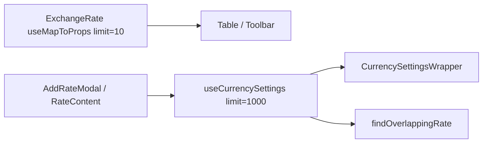

# AddRate own currency fetch for overlap validation

## Context

[COST-8565](https://redhat.atlassian.net/browse/COST-8565): Create Exchange Rate overlap checks reuse the parent table’s `settings/currency/` response (`limit=10`). Currencies past page 1 (e.g. `INR`) have no `static_rates` in that payload, so overlaps are missed.

[`addRate.tsx`](../../apps/koku-ui-hccm/src/routes/settings/exchangeRates/exchangeRate/components/add/addRate.tsx) only opens the modal and forwards `settings` from the toolbar. [`RateContent`](../../apps/koku-ui-hccm/src/routes/settings/exchangeRates/exchangeRate/components/rateContent.tsx) runs `findOverlappingRate(settings, …)` on that list. [`AddRateModal`](../../apps/koku-ui-hccm/src/routes/settings/exchangeRates/exchangeRate/components/add/addRateModal.tsx) already has a `useMapToProps`, but only for `currencyAdd` update status—not the currency list.

## Approach

Reuse the existing dropdown fetch: [`useCurrencySettings`](../../apps/koku-ui-hccm/src/routes/components/currency/utils/hooks.ts) already requests `settings/currency/?limit=1000` (no `enabled` filter). Create-modal overlap checks use that same Redux cache entry instead of a second query with `offset` / `order_by`.

Scope is **create flow**. Edit/duplicate still pass table `settings` for the row being edited; COST-8565’s repro is create with a base currency off page 1.

## Implementation

1. **[`rateContent.tsx`](../../apps/koku-ui-hccm/src/routes/settings/exchangeRates/exchangeRate/components/rateContent.tsx)**  
   - Call `useCurrencySettings()` and use `settings ?? currencySettings?.data` for overlap (and rate lookup when props are omitted).

2. **[`addRate.tsx`](../../apps/koku-ui-hccm/src/routes/settings/exchangeRates/exchangeRate/components/add/addRate.tsx)**  
   - Do not fetch or pass `settings`; dropdowns and overlap share one `limit=1000` request when the modal mounts.

3. **Call sites**  
   - Toolbar / empty state no longer pass table `settings` into `AddRate`.

4. **Docs**  
   - Effort `0006` plan/spec/decision record the shared-query approach.

## Out of scope

- Edit/Duplicate rate modals  
- Changing table pagination or `RateContent` overlap logic itself  
- Backend API changes
