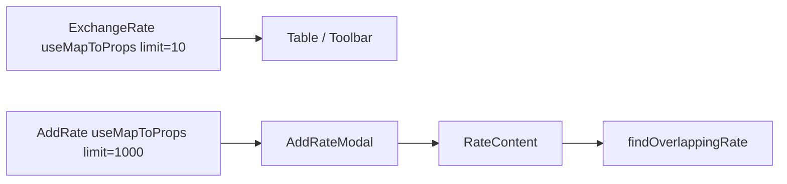

# AddRate own currency fetch for overlap validation

## Context

[COST-8565](https://redhat.atlassian.net/browse/COST-8565): Create Exchange Rate overlap checks reuse the parent table’s `settings/currency/` response (`limit=10`). Currencies past page 1 (e.g. `INR`) have no `static_rates` in that payload, so overlaps are missed.

[`addRate.tsx`](../../apps/koku-ui-hccm/src/routes/settings/exchangeRates/exchangeRate/components/add/addRate.tsx) only opens the modal and forwards `settings` from the toolbar. [`RateContent`](../../apps/koku-ui-hccm/src/routes/settings/exchangeRates/exchangeRate/components/rateContent.tsx) runs `findOverlappingRate(settings, …)` on that list. [`AddRateModal`](../../apps/koku-ui-hccm/src/routes/settings/exchangeRates/exchangeRate/components/add/addRateModal.tsx) already has a `useMapToProps`, but only for `currencyAdd` update status—not the currency list.

## Approach

Yes: give [`addRate.tsx`](../../apps/koku-ui-hccm/src/routes/settings/exchangeRates/exchangeRate/components/add/addRate.tsx) its own `useMapToProps`, shaped like [`exchangeRate.tsx`](../../apps/koku-ui-hccm/src/routes/settings/exchangeRates/exchangeRate/exchangeRate.tsx) lines 275–329, with a fixed query:

- `filter: { enabled: true }` (same default as the table)
- `limit: 1000`, `offset: 0`
- `order_by: { code: 'asc' }`

No `filter[currency]` / base-currency refetch. Redux already keys cache by query string, so this does not collide with the table’s `limit=10` entry. Same `limit: 1000` pattern already exists in price-list fetch helpers.

Scope is **AddRate only**. Edit/duplicate operate on a row already present in the current page’s `settings`, so that currency’s `static_rates` are available; COST-8565’s repro is create with a base currency off page 1.

## Implementation

1. **[`addRate.tsx`](../../apps/koku-ui-hccm/src/routes/settings/exchangeRates/exchangeRate/components/add/addRate.tsx)**  
   - Add `useMapToProps` that dispatches `settingsActions.fetchSettings(SettingsType.currency, queryString)` and selects settings/error/status.  
   - Pass `settings?.data` into `AddRateModal` (stop requiring parent-supplied list).  
   - Drop `settings` from `AddRateOwnProps` (call sites no longer pass it).

2. **Call sites**  
   - [`exchangeRateToolbar.tsx`](../../apps/koku-ui-hccm/src/routes/settings/exchangeRates/exchangeRate/exchangeRateToolbar.tsx): stop passing `settings` into `AddRate` (toolbar can keep `settings` for other uses if any; today it only forwards to AddRate).  
   - [`noExchangeRateAssignedState.tsx`](../../apps/koku-ui-hccm/src/routes/settings/exchangeRates/exchangeRate/components/state/noExchangeRateAssignedState.tsx): unchanged props aside from no longer needing settings.

3. **Tests**  
   - Update [`addRate.test.tsx`](../../apps/koku-ui-hccm/src/routes/settings/exchangeRates/exchangeRate/components/add/addRate.test.tsx) to mock `react-redux` / settings selectors (or wrap with a store) so `useMapToProps` does not throw.  
   - Adjust toolbar tests if they assert `settings` on `AddRate`.

4. **Docs (on approval)**  
   - Effort `0006`: `docs/plans/0006-add-rate-currency-fetch.md`, `docs/specs/0006-add-rate-currency-fetch.md`.  
   - Decision `docs/decisions/0006-001-limit-over-base-filter.md`: choose full `limit=1000` list over the ticket’s per–base-currency filter refetch.

## Out of scope

- Edit/Duplicate rate modals  
- Changing table pagination or `RateContent` overlap logic itself  
- Backend API changes
