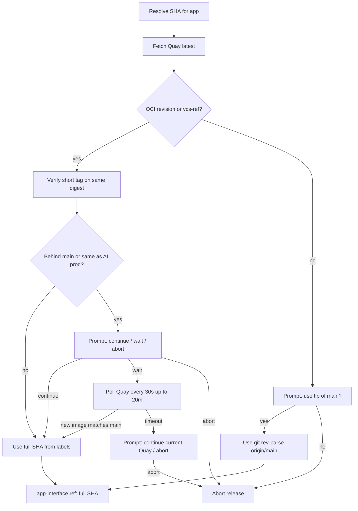

# Quay-backed release SHA selection

## Verdict

Yes — tip-of-main can lack a deployable image. Prefer Quay. If image config labels cannot be read, **ask** before falling back to tip-of-main (do not fall back silently).

Today [`scripts/release/release-app-interface.sh`](../../scripts/release/release-app-interface.sh) sets both apps from `git rev-parse origin/main` with **no image check**. App-interface still needs an immutable git `ref` (not the mutable `latest` tag). Deploy Quay tags are **7-char short SHAs** plus `latest`; full SHAs are not tags on `redhat-services-prod`. The image config does carry the full commit in `org.opencontainers.image.revision` / `vcs-ref`.

Verified on Quay (2026-11-04): both `koku-ui-hccm` and `koku-ui-ros` `latest` resolve to full SHA `5d28d4fe0795007bdfd494e43460484f8c5de29c`, with matching short tag `5d28d4f`.

## Chosen approach

**Per app, resolve SHA from that app’s deploy Quay `latest` image.** Write the full revision into app-interface `ref` as today.

If Quay `latest` exists but config labels are missing (or Quay/manifest lookup fails before a SHA is obtained):

1. Print a clear warning (labels unavailable; main tip may not have an image yet).
2. Prompt interactively: use tip-of-main SHA, or abort.
3. Only proceed with main tip if the user confirms.

If Quay SHA differs from tip of `main` and/or matches the current app-interface prod SHA:

1. Warn (behind main and/or no deployment change).
2. Prompt: continue with Quay SHA, wait for a newer image, or abort (default abort).
3. Wait polls Quay every 30s for up to 20 minutes until Quay SHA differs from the wait-start SHA and equals refreshed `origin/main`. On timeout, ask whether to continue with the current Quay SHA or abort.

Rejected: silent always-main; silent Quay-then-main fallback without asking.

**JSON parsing:** use `jq` (same pattern as [`scripts/onprem/setup-operator.sh`](../../scripts/onprem/setup-operator.sh)), not `python3`.

## Implementation

1. Add helpers in [`scripts/release/release-app-interface.sh`](../../scripts/release/release-app-interface.sh):
   - Query `https://quay.io/api/v1/repository/redhat-services-prod/cost-mgmt-dev-tenant/<app>/tag/?specificTag=latest&onlyActiveTags=true`
   - Load manifest → config blob → `org.opencontainers.image.revision` (fallback `vcs-ref`) via `jq`
   - Confirm short tag `${SHA:0:7}` exists on the same digest
   - Optionally confirm `git merge-base --is-ancestor $SHA origin/main` in the cloned repo
   - Require `jq` up front (`command -v jq`)
   - `confirmQuaySHA` / `waitForQuayImage` for behind-main and same-as-prod prompts
2. Change `initKokuUISHA` so HCCM/ROS SHAs come from Quay when that app is being deployed; pass both prod frontends and prod multicluster app-interface SHAs into `resolveAppSHA` / `confirmQuaySHA` (match either for the no-change warning).
3. On missing labels / failed Quay resolution: interactive confirm (`read` in the shell script so both direct `-s`/`-t` and `release-all.js` paths get the prompt). Default to **no** (abort) so a non-TTY / accidental Enter does not pin an unverified SHA.
4. Keep writing **full** SHA to `ref:`. Do not put `latest` in app-interface. Reject Quay labels that are not a full 40-character lowercase hex SHA.
5. Update [`apps/koku-ui-hccm/RELEASE.md`](../../apps/koku-ui-hccm/RELEASE.md) and [`apps/koku-ui-ros/RELEASE.md`](../../apps/koku-ui-ros/RELEASE.md): prod pin prefers Quay `latest` revision; document the main-fallback and continue/wait/abort prompts.

## Staggered hccm then ros

Each run pins that app’s current Quay `latest`. If main moves and a new image promotes between runs, ROS can correctly get a newer SHA than HCCM — and a Quay-resolved SHA always has an image. A tip-of-main chosen via fallback may not. Releasing `all` in one run resolves each app independently (usually the same commit after a shared main push).
